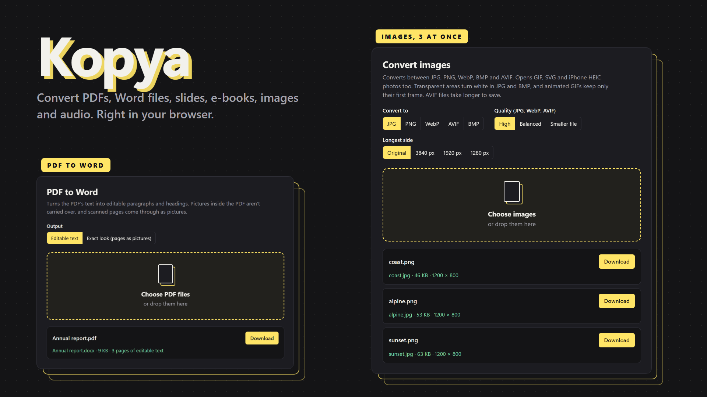
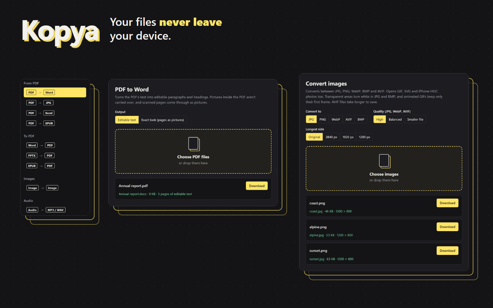

# Kopya

**Convert PDFs, Word files, slides, e-books, images and audio right in your browser. Your files never leave your device.**

## About

Kopya is a free file converter. Pick a tool, drop in your files and download the result. Nothing is uploaded to a server, so it is safe to use on confidential documents.

*The files in these pictures are made-up samples.*

**[Try it: direkjames.github.io/Kopya](https://direkjames.github.io/Kopya/)**

## Features

**From PDF**
- **PDF to Word:** editable text with headings, bold and italics, or an "exact look" mode that keeps each page as a picture
- **PDF to JPG:** a picture of every page, downloaded as a ZIP when there are several
- **PDF to Excel:** rows and columns rebuilt from the text, best on simple tables
- **PDF to EPUB:** a reflowable e-book with chapters taken from the headings

**To PDF**
- **Word to PDF:** keeps styles, lists, tables, pictures, headers, footers and page numbers
- **PowerPoint to PDF:** keeps themes, layouts, text, shapes, pictures, tables and SmartArt
- **EPUB to PDF:** A5, A4 or Letter pages with page numbers and the cover

**Images**
- Convert between JPG, PNG, WebP, AVIF and BMP, and open GIF, SVG and iPhone HEIC photos
- Three quality levels, and an optional limit on the longest side (3840, 1920 or 1280 px)
- Very large pictures are shrunk automatically, and Kopya tells you

**Audio**
- Turn WAV, OGG, M4A, AAC and FLAC into MP3 at 128, 192, 256 or 320 kbps
- Turn any of them, MP3 included, into WAV

**Good to know**
- Drop in several files at once and download each result
- Open a tool directly with a link such as `#pdf-to-word`
- The "to PDF" tools save each page as a picture, so the text in those PDFs can't be searched or copied
- Old `.doc` and `.ppt` files need to be saved as `.docx` and `.pptx` first
- DRM-protected e-books can't be converted, and animated GIFs keep only their first frame
- Audio files over 150 MB or 3 hours are refused

## Getting started

1. Open [direkjames.github.io/Kopya](https://direkjames.github.io/Kopya/).
2. Choose a tool from the list on the left.
3. Drop your files in, or press **Choose files**.
4. Press **Download** next to each finished file.

## Requirements

- A modern web browser (Chrome, Edge, Firefox or Safari)
- An internet connection the first time the page loads. Which audio formats can be opened depends on your browser; Safari can't open OGG.

## Built with

- HTML, CSS and JavaScript, with no build step
- [PDF.js](https://mozilla.github.io/pdf.js/), [pdf-lib](https://pdf-lib.js.org), [docx](https://docx.js.org), [JSZip](https://stuk.github.io/jszip/) and [html-to-image](https://github.com/bubkoo/html-to-image)
- [lamejs](https://github.com/zhuker/lamejs) for MP3, [libheif](https://github.com/strukturag/libheif) for HEIC and [jSquash](https://github.com/jamsinclair/jSquash) for AVIF

All libraries are bundled, so Kopya doesn't depend on a CDN. Want to run it yourself? See [Developing Kopya](docs/DEVELOPING.md).

## Status

Shipped.

## Credits / License

Made by [direkjames](https://github.com/direkjames). Third-party licenses are in [vendor/licenses/THIRD-PARTY-NOTICES.txt](vendor/licenses/THIRD-PARTY-NOTICES.txt). See [LICENSE](LICENSE).
